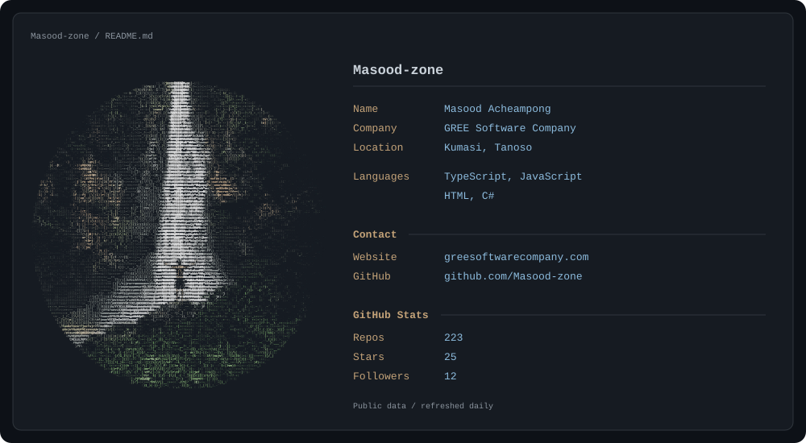

<picture>
  <source media="(prefers-color-scheme: dark)" srcset="assets/profile-dark.svg">
  <source media="(prefers-color-scheme: light)" srcset="assets/profile-light.svg">
  
</picture>

[Website](https://www.greesoftwarecompany.com) · [GitHub](https://github.com/Masood-zone)

About this profile

The waterfall artwork is generated from the supplied photograph using ASCII characters. The panel follows your GitHub theme, and its public statistics refresh daily at 06:00 UTC.

To edit the professional details, update `profile.json`. To refresh the artwork and public statistics, run the **Refresh profile** workflow manually, or install `requirements.txt` and run `python scripts/generate.py`.

Statistics count owned public repositories (including forks), stars on those repositories, and followers. No private repository data is requested. A failed refresh preserves the previously published assets.

